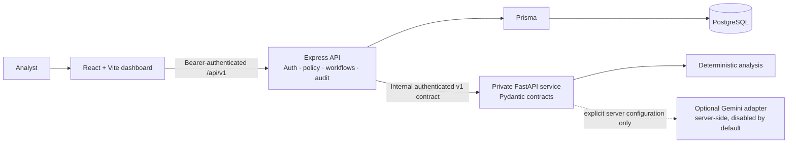

# CyberNexus

### An explainable, analyst-led SOC workflow—from alert intake to an auditable response plan.

CyberNexus is a security operations center (SOC) prototype for turning synthetic or authorized alerts into traceable incident investigations. It combines deterministic correlation, evidence-scoped AI assistance, transparent prioritization, SLA visibility, and constrained analyst assignment in one workflow.

The interface has two honest modes: a clearly labelled synthetic demo workspace, and an authenticated view backed by the CyberNexus Express API. Analysis and assignment suggestions are advisory. Analysts remain responsible for review and consequential decisions.

> **Project status:** This is a development prototype, not a production-ready SOC platform. The core workflow and connected dashboard exist, with documented gaps in end-to-end browser validation, evaluation metrics, provider verification, and deployment readiness. The canonical status is in the [implementation plan](docs/implementation-plan.md) and [Phase 17 report](docs/phase-17-final-validation.md).

## Contents

- [Why CyberNexus](#why-cybernexus)
- [What works today](#what-works-today)
- [How the system fits together](#how-the-system-fits-together)
- [Technology](#technology)
- [Repository map](#repository-map)
- [Run it locally](#run-it-locally)
- [Configuration and security](#configuration-and-security)
- [Data and integrations](#data-and-integrations)
- [Verification](#verification)
- [Known limitations](#known-limitations)
- [Roadmap and project docs](#roadmap-and-project-docs)
- [Contributing and license](#contributing-and-license)

## Why CyberNexus

Security teams need to move quickly while preserving why an alert became an incident, what evidence supports a conclusion, and who authorized a response. CyberNexus is built around that traceability:

- **Explainable relationships:** correlation records the matching evidence and rationale instead of merging alerts on timestamps alone.
- **Evidence-scoped investigation:** analysis references records and fields from the incident snapshot. Referential validation is not semantic proof that a claim is true.
- **Transparent risk and response:** deterministic priority and SLA rules show their inputs and limitations; response steps are suggestions until an authorized human acts.
- **Constrained assignment:** the application owns qualifications, availability, capacity, application, and audit policy. What-if simulation remains separate from applied assignments.
- **Honest system state:** demo fixtures are labelled; unavailable records stay unavailable; service health is not presented as model connectivity.

## What works today

“Implemented” describes code and tests in this repository. It does not imply production deployment, a live external provider, or a completed cross-layer browser acceptance run.

| Capability                                | Status                                | What that means                                                                                                                                                                                              |
| ----------------------------------------- | ------------------------------------- | ------------------------------------------------------------------------------------------------------------------------------------------------------------------------------------------------------------ |
| Synthetic alert fixtures and ground truth | **Implemented**                       | Versioned synthetic records support reproducible development and tests. They are not operational telemetry.                                                                                                  |
| Alert ingestion and normalization         | **Implemented**                       | Authenticated Express ingest, batch handling, validation, duplicate handling, listing, and audit behavior use the existing API contracts.                                                                    |
| Explainable correlation and incidents     | **Implemented**                       | The private deterministic analysis service proposes evidence-linked relationships; Express validates and persists eligible incidents. Incident detail, graph, timeline, and status workflows exist.          |
| AI-assisted investigation                 | **Implemented with limits**           | FastAPI provides deterministic analysis and a mocked-tested Gemini adapter. Evidence references and response shape are checked; claims remain unverified and require human review.                           |
| Prioritization, SLA and response plans    | **Implemented**                       | Express applies deterministic, documented rules. Suggested response steps are review-required and are not marked performed.                                                                                  |
| Analyst assignment                        | **Implemented with limits**           | A deterministic, constraint-checked baseline supports recommendations, application, history, and separate what-if simulation. It is not a global optimizer.                                                  |
| Connected SOC dashboard                   | **Implemented with gaps**             | Authenticated views use supported Express APIs for alerts, incidents, analysis, prioritization/SLA, assignment, timeline, graph, and incident-scoped audit. Missing data is shown as missing or unavailable. |
| Evaluation metrics                        | **Not available**                     | Synthetic fixtures and ground truth exist, but there is no connected metrics endpoint or validated aggregate model-quality report. The UI does not invent metrics.                                           |
| Gemini live connectivity                  | **Not verified; disabled by default** | The official Google GenAI SDK adapter is tested with mocks. No live request has been verified; health indicators do not call Gemini.                                                                         |
| QpiAI Opt / Agent Hive                    | **Not integrated**                    | Opt's current model/job/result interface and usage constraints are unverified. No Agent Hive workflow or orchestration framework is selected.                                                                |
| Production deployment                     | **Not completed**                     | No external deployment, production secret management, or production readiness approval is claimed.                                                                                                           |

See the [connected dashboard report](docs/connected-soc-dashboard.md), [Gemini integration report](docs/gemini-provider-integration.md), and [assignment integration report](docs/assignment-optimization.md) for evidence and detailed acceptance limits.

## How the system fits together

The browser talks only to the public Express application API. Express owns identity, authorization, business policy, persistence, and audit. FastAPI is an authenticated internal service for specialized analysis; it does not own application persistence or public authorization.



The Gemini branch is not enabled or live-verified in the checked-in configuration. Model output is untrusted input: validated data may inform an advisory analysis, but the model cannot authorize, prioritize, assign, persist, or execute an action.

## Technology

- **Web:** React, TypeScript, Vite, Tailwind CSS, Recharts
- **Application API:** Node.js, Express, TypeScript, Zod
- **Analysis service:** Python 3.11+, FastAPI, Pydantic
- **Persistence:** PostgreSQL through Prisma, with Express as the sole application write owner
- **Contracts:** versioned JSON contracts shared and validated across TypeScript and Python
- **Workspace and checks:** pnpm workspaces, Vitest, pytest, TypeScript, ESLint, Prettier
- **Optional model adapter:** Google's official `google-genai` Python SDK; deterministic mode remains the default

## Repository map

```text
apps/
  api/                 Express routes, workflows, authorization, Prisma access and tests
  web/                 React dashboard, API client/proxy and UI tests
packages/
  shared/              Versioned TypeScript contracts and synthetic contract fixtures
services/
  ai/                  Private FastAPI analysis/correlation service and pytest suite
data/
  demo/                Clearly labelled synthetic demo records
  synthetic/           Versioned synthetic fixtures and ground truth for tests
docs/                  Architecture, workflow, phase reports and canonical roadmap
```

## Run it locally

### Prerequisites

- Node.js 22 or newer
- pnpm 11.25.0 (pinned by the repository)
- Python 3.11 or newer for FastAPI
- PostgreSQL 16 or newer for database-backed API workflows

The synthetic dashboard can be viewed without a database. Persisted workflows require a configured local database and API credentials. Do not point development or test commands at production data.

### Install dependencies

From the repository root:

```sh
pnpm install --frozen-lockfile
```

Create the Python environment and install the AI service (PowerShell):

```powershell
py -m venv services/ai/.venv
.\services\ai\.venv\Scripts\python.exe -m pip install -e "services/ai[dev]"
```

macOS/Linux:

```sh
python3 -m venv services/ai/.venv
services/ai/.venv/bin/python -m pip install -e "services/ai[dev]"
```

### Configure local services

Copy templates only when the destination does not already exist; edit ignored local files privately and preserve any existing configuration.

PowerShell:

```powershell
if (-not (Test-Path .env)) { Copy-Item .env.example .env }
if (-not (Test-Path services/ai/.env)) { Copy-Item services/ai/.env.example services/ai/.env }
```

macOS/Linux:

```sh
[ -f .env ] || cp .env.example .env
[ -f services/ai/.env ] || cp services/ai/.env.example services/ai/.env
```

Set a valid local `DATABASE_URL` only if you intend to use database-backed workflows. Use an isolated local development database. The API bearer credentials are configured server-side as JSON in `CYBERNEXUS_API_TOKENS_JSON`; give each credential only the scopes it needs (`api:read`, `api:write`, and, for audit views, `audit:read`). The dashboard asks the analyst for the bearer token at runtime and holds it in page memory; do not place it in source or a `VITE_` variable.

For FastAPI-backed requests, set a high-entropy `CYBERNEXUS_AI_SERVICE_TOKEN` privately in both the root `.env` and `services/ai/.env`; the values must match. The API also needs `AI_SERVICE_URL` (local default: `http://127.0.0.1:8000`). Keep `AI_PROVIDER=deterministic` and `GEMINI_LIVE_ENABLED=false`. No Gemini key is needed for deterministic analysis.

The Express loader reads the repository-root `.env`. FastAPI does **not** automatically load `services/ai/.env`; pass it using the documented Uvicorn `--env-file` option below. Never copy a real key into a template, browser variable, report, or log.

### Start the app

Terminal 1, from the repository root, starts Vite and Express:

```sh
pnpm dev
```

Terminal 2 starts FastAPI. PowerShell:

```powershell
.\services\ai\.venv\Scripts\python.exe -m uvicorn cybernexus_ai.main:app --reload --host 127.0.0.1 --port 8000 --app-dir services/ai/src --env-file services/ai/.env
```

macOS/Linux:

```sh
services/ai/.venv/bin/python -m uvicorn cybernexus_ai.main:app --reload --host 127.0.0.1 --port 8000 --app-dir services/ai/src --env-file services/ai/.env
```

Open `http://127.0.0.1:5173`. Without connecting an authorized API token, the dashboard uses its labelled synthetic demo workspace. Connected workflows require Express credentials and, where relevant, a reachable database and authenticated FastAPI service.

| Address                                         | What it checks                                               |
| ----------------------------------------------- | ------------------------------------------------------------ |
| `http://127.0.0.1:5173`                         | Vite web app                                                 |
| `http://127.0.0.1:5173/api/health`              | Vite proxy to Express liveness                               |
| `http://127.0.0.1:5173/api/health/dependencies` | Vite proxy to bounded database and FastAPI dependency checks |
| `http://127.0.0.1:3001/health`                  | Express liveness only                                        |
| `http://127.0.0.1:3001/health/dependencies`     | Database reachability and authenticated FastAPI readiness    |
| `http://127.0.0.1:8000/health`                  | FastAPI health                                               |

These checks do not verify Gemini connectivity. Gemini remains disabled or unverified unless an explicitly authorized live request is separately performed.

## Configuration and security

- `.env` and `services/ai/.env` are local configuration files; keep credentials out of source control. `.env.example` files contain placeholders, not secrets.
- Keep public API tokens and the internal API-to-AI service token on the server side. Never put them in frontend source, Vite-exposed environment variables, screenshots, or logs.
- Set `AI_PROVIDER=deterministic` and `GEMINI_LIVE_ENABLED=false` for local development. Before any external provider use, the project owner must review account/application eligibility, region, provider terms, and approved data handling. Never send sensitive, personal, confidential, or production security data as test input.
- Alert titles, payloads, logs, evidence, and model output are untrusted. They cannot change application policy or authorize action.
- Express validates service output, scopes references to the incident snapshot, and owns persistence and audit. Reference validity does not establish that a statement is semantically supported by evidence.
- Assignment what-if results are proposals and do not apply assignments. Application requires the authorized Express workflow and its constraints.
- Health responses distinguish liveness/dependency reachability from provider configuration. A healthy FastAPI service does not mean Gemini is connected.

See [AGENTS.md](AGENTS.md), the [project blueprint](docs/project-blueprint.md), and the [architecture notes](docs/architecture.md) for the trust boundaries and data-handling rules.

## Data and integrations

The repository's sample data is synthetic; [data/demo/README.md](data/demo/README.md) describes the demo records. Versioned synthetic fixtures and ground truth live under `data/synthetic/`. They support development and tests, not claims about detection accuracy in a real SOC.

The current ingestion API accepts validated alert records. The repository does not include verified live vendor connectors for SIEM, EDR, identity, or cloud telemetry. Gemini is an optional server-side analysis adapter, not an ingestion connector or an autonomous response agent. QpiAI Opt and Agent Hive are not integrated. No live external provider request or deployment is claimed.

## Verification

Run the repository checks from its root:

```sh
pnpm check:env
pnpm lint
pnpm format:check
pnpm typecheck
pnpm test
pnpm build
git diff --check
```

Run Python service tests with the project environment:

```powershell
.\services\ai\.venv\Scripts\python.exe -m pytest -q services\ai\tests
```

```sh
services/ai/.venv/bin/python -m pytest -q services/ai/tests
```

`pnpm test` runs shared, API, and web suites. PostgreSQL integration tests are guarded and skip when `CYBERNEXUS_TEST_DATABASE_URL` is absent. When configured, they require a loopback host and the exact dedicated database name `cybernexus_test`; never substitute the development database. Inspect database identity and migration status before running them. `pnpm check:workspace` is an optional frozen-lockfile/offline workspace check; it may require metadata available only in the configured pnpm mirror.

Validation caveats and the last recorded test evidence are in [Phase 17](docs/phase-17-final-validation.md). In particular, a serialized database-backed API suite passed, while the concurrent full API suite has a recorded correlation integration failure; do not interpret the serial result as resolution of that failure. No browser-driven scenario spanning the whole workflow has been completed.

## Known limitations

- No independently validated aggregate evaluation metrics endpoint exists; synthetic ground truth alone is not an evaluation result.
- Evidence-reference validation is implemented, but semantic evidence support is not verified. Findings preserve uncertainty and require human review.
- Gemini's adapter has mocked coverage only. Live connectivity and owner eligibility/data-use approval are not verified.
- QpiAI Opt's safe current API contract and usage constraints remain unverified; no Agent Hive/orchestration workflow is selected.
- The connected dashboard has API/UI tests, but a browser-to-database end-to-end scenario remains outstanding. Some status endpoints and global data views are unavailable by design and show unknown/unavailable.
- The concurrent full API run has a recorded integration failure even though isolated and serialized executions passed. See the [Phase 17 validation report](docs/phase-17-final-validation.md).
- No external deployment, production operations runbook, or license file is included.

## Roadmap and project docs

The [canonical implementation plan](docs/implementation-plan.md) is the single roadmap and records 20 phases, including historical phase mappings. The [project blueprint](docs/project-blueprint.md) describes intended architecture and trust boundaries; intended scope is not evidence that every capability is complete.

| Document                                                                     | Focus                                                           |
| ---------------------------------------------------------------------------- | --------------------------------------------------------------- |
| [Architecture](docs/architecture.md)                                         | Supporting component boundaries                                 |
| [Alert ingestion](docs/alert-ingestion.md)                                   | Validation, normalization, authenticated ingest                 |
| [Correlation and incidents](docs/correlation-and-incidents.md)               | Explainable relationships and incident workflows                |
| [Analysis and evidence validation](docs/analysis-and-evidence-validation.md) | Deterministic analysis, Gemini adapter, validation limits       |
| [Prioritization, SLA and audit](docs/prioritization-sla-audit.md)            | Risk policy, deadlines, response suggestions, audit             |
| [Assignment optimization](docs/assignment-optimization.md)                   | Baseline, constraints, simulation, QpiAI blocker                |
| [Connected dashboard](docs/connected-soc-dashboard.md)                       | API integration and unavailable views                           |
| [Node–Python integration](docs/node-python-integration.md)                   | Private service boundary and contract checks                    |
| [Gemini integration](docs/gemini-provider-integration.md)                    | Provider configuration and verification history                 |
| [Phase 17 validation](docs/phase-17-final-validation.md)                     | Test evidence, security/evaluation limits, deployment readiness |

## Contributing and license

Contributor guidance is in [AGENTS.md](AGENTS.md). Keep changes within the authorized phase, preserve existing work, use synthetic data for reproducible tests, and document evidence and limitations without overstating provider or product status. There is no separate `CONTRIBUTING.md` at present.

No `LICENSE` file is present, so this repository does not currently specify an open-source license. Do not assume permission to reuse or redistribute it; contact the project owner for licensing terms.
